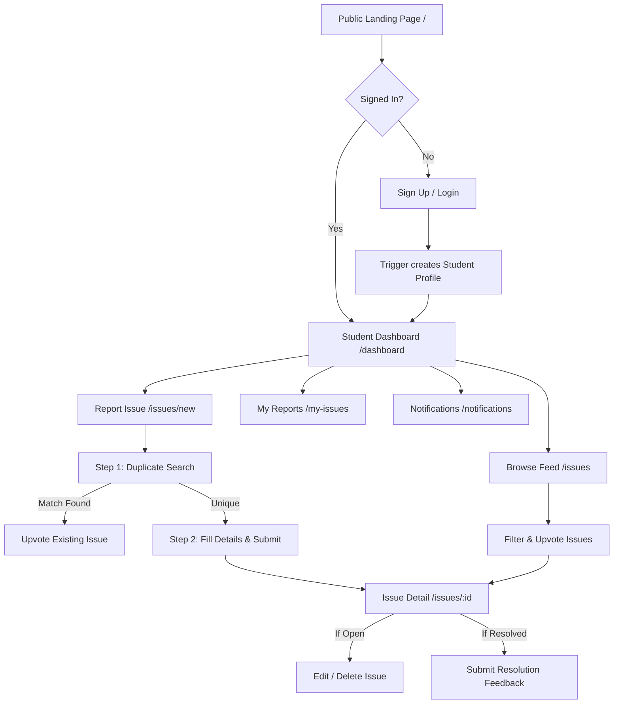
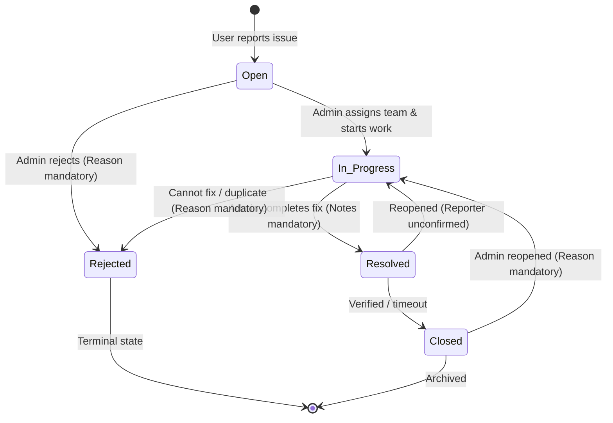

# CampusFix — Core User Flows

## 1. Student / Faculty Journey



---

## 2. Administrator Triage & Resolution Journey

```mermaid
flowchart TD
    AdminLogin[Admin Login] --> RoleCheck{Role == 'admin'?}
    RoleCheck -- No --> Denied[Redirect to /dashboard]
    RoleCheck -- Yes --> AdminDash[/admin - Overview & KPIs]
    
    AdminDash --> Triage[/admin/issues - Triage Table]
    AdminDash --> Analytics[/admin/analytics - Performance]
    AdminDash --> Users[/admin/users - Role Control]
    AdminDash --> Settings[/admin/settings - Campus Config]
    
    Triage --> Detail[/admin/issues/:id - Control Center]
    Detail --> Action1[Adjust Urgency / Priority]
    Detail --> Action2[Assign Maintenance Team]
    Detail --> Action3[Post Official Public Update]
    Detail --> Action4[Save Confidential Internal Note]
    Detail --> Action5[Change Status with Mandatory Notes]
    
    Action5 --> Notif[In-App Notification Sent to Reporter]
```

---

## 3. Issue Status State Machine


